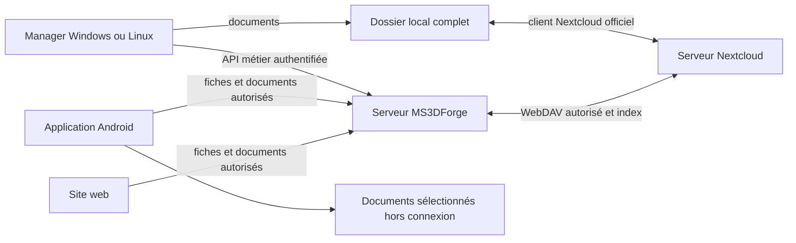

# Conception technique — atelier MS3DForge et documents Nextcloud

Date : 6 novembre 2026. Code étudié : `746f6d7`. Statut : conception pour implémentation, sans activation ni déploiement associé.

Spécification fonctionnelle : [atelier unique](../../atelier-unifie-nextcloud.md).

## 1. Architecture



MS3DForge est la référence des enregistrements métier après migration. Nextcloud est la référence du contenu documentaire. Les PC possèdent un miroir documentaire complet et une projection métier de lecture. Aucun deuxième moteur de synchronisation bidirectionnelle des fichiers PC n'est développé.

## 2. Contraintes communes

- .NET 10, Avalonia 12.1.4 et ASP.NET Core existants ; Windows x64, Ubuntu/Linux Mint, Android existant.
- Nom de lancement Windows : `MS3DPRINT Manager.exe`.
- Aucun document métier, secret ou cache dans Git ou dans le dossier du programme.
- Copie documentaire complète sur chaque PC déclaré prêt ; des placeholders ne constituent pas une copie complète.
- Métier hors connexion en consultation dans cette première version ; pas de file générique d'écritures métier hors connexion.
- Compte propriétaire actuel comme premier périmètre ; aucune inscription publique avant isolation des comptes et ateliers.
- Les services MS3DPRINT-FR et MS3DPRINT-SHOP restent hors périmètre.

## 3. Points du code à découpler

| Code existant | Limite | Évolution |
|---|---|---|
| `Core/Storage/ApplicationPaths.cs` | Réglages Windows voisins de l'exécutable | Profil OS stable et migration des anciens réglages |
| `Core/Storage/WorkspaceLocation.cs` | Racine locale/défaut historique | Association par identifiant d'atelier ; défaut réservé à la récupération |
| `Core/Workspace/WorkspaceMetadataPaths.cs` | Métadonnées sous la racine des documents | Racine explicite de métadonnées ; préserver le constructeur historique |
| `Desktop/WorkspaceStartupMode.cs`, `MainWindow.Remote.cs` | Modes local/serveur séparés | Démarrage guidé et refus du repli implicite en écriture locale |
| `Core/Remote/RemoteWorkspaceCache.cs` | Projection clients/projets | Projection par compte/atelier et par modules, sans jetons |
| `Server/Workspace/WorkspaceCommands.cs` | Création des dossiers sur le disque MS3DForge | Opération documentaire Nextcloud suivie séparément de la fiche |
| `Server/Workspace/WorkspaceReader.cs` | Lecture liée aux dossiers historiques | Lecture des fiches même si un dossier attend sa création |
| Stores métiers et journaux | Chemins `.ms3dprint-manager` construits dans plusieurs classes | Routage explicite vers le contexte métier approprié |
| `Core/Storage/SyncFolderDetector.cs` | Détection d'un dossier sans preuve de son identité | Vérification du marqueur d'atelier et de la liaison serveur |
| Hôtes Android et vues `RemoteWorkspaceView*.cs` | Réutilisation partielle | Ajouter documents et stockage mobile dans l'hôte existant |

Conserver les stores JSON et leurs validateurs côté serveur pour commencer. Réutiliser SQLite déjà présent pour les registres, liens et opérations. Aucune conversion générale vers une nouvelle base n'est requise.

## 4. Identité et contrats cibles

Identifiants stables : `WorkspaceId`, `AccountId`, `StorageBindingId`, `DocumentId`, `DeviceId`. Conserver les identifiants métier existants. Attribuer durablement un identifiant au propriétaire actuel, sans fabriquer un système d'inscription publique.

```csharp
public sealed record WorkspaceDescriptor(Guid WorkspaceId, string AccountId,
    string Name, int SchemaVersion, long Revision, DocumentStorageDescriptor? Documents);
public sealed record DocumentStorageDescriptor(Guid StorageBindingId,
    string Provider, string ProviderInstanceId, string WorkspaceMarkerId);
public sealed record LocalWorkspaceBinding(Guid WorkspaceId, string AccountId,
    Uri Server, Guid StorageBindingId, string LocalDocumentsRoot);
public sealed record DocumentLink(Guid DocumentId, Guid WorkspaceId,
    Guid StorageBindingId, Guid? ClientId, Guid? ProjectId, string RelativePath,
    string? ProviderFileId, string? RemoteEtag, long Bytes,
    string? VerifiedSha256, string State, DateTimeOffset ObservedAt);
```

Ces types sont des interfaces à implémenter, pas des contrats déjà déployés.

Le fichier est identifié par `StorageBindingId + ProviderFileId`. L'identifiant fournisseur reste une chaîne opaque ; aucun chemin Windows ni conversion en petit entier. Un changement d'instance/restauration Nextcloud peut imposer une réassociation contrôlée.

Le serveur garde le chemin Nextcloud relatif au compte technique dans son registre privé. Les racines absolues restent sur chaque appareil. Une réponse publique de configuration ne renvoie ni chemin de l'hôte ni secret du fournisseur.

## 5. Emplacements

Windows utilise `%LOCALAPPDATA%/MS3DPRINT Manager/` pour préférences, associations et projections. Linux utilise le dossier de données du profil via `XDG_DATA_HOME`. Les sessions restent dans le coffre Windows ou Secret Service. Android utilise un stockage persistant et le coffre Keystore.

Les documents PC restent dans la racine Nextcloud effectivement synchronisée. Sur le serveur, état privé, métadonnées et sauvegardes restent distincts.

Pour les anciens réglages voisins de l'exécutable : sauvegarder puis importer si aucune configuration stable n'existe. Ne pas écraser une association déjà liée à un autre atelier. Les réglages machine ne sont pas des réglages partagés d'atelier.

## 6. Démarrage et session

États : `NeedsSignIn`, `NeedsWorkspaceSelection`, `NeedsDocumentsBinding`, `HydratingDocuments`, `ReadyOnline`, `ReadyOfflineReadOnly`, `RecoveryRequired`.

Sélectionner automatiquement l'atelier si un seul est autorisé. Appareil neuf : réseau et connexion nécessaires. Appareil connu hors connexion : projection préalablement vérifiée pour ce compte/atelier uniquement. Aucun passage automatique à un autre atelier modifiable.

Réutiliser `/api/v1/auth/login`, `/session`, `/logout` et les coffres existants. La session actuelle expire : ne pas promettre une mémorisation permanente ni ajouter implicitement un jeton de longue durée.

Après déconnexion ou changement de compte, ne pas afficher la projection du précédent compte. Les documents visibles dans l'Explorateur restent soumis aux droits du profil OS ; une déconnexion n'efface pas ce miroir.

La consultation hors connexion exige une autorisation locale issue d'une connexion réussie pour cette identité. Une déconnexion explicite retire cette autorisation ; la seule présence du fichier de cache ne permet pas de contourner le prochain écran de connexion.

Les capacités serveur indiquent modules, schéma et protocole documentaire. Une version ancienne provoque une demande de mise à jour, sans migration improvisée.

## 7. Liaison Nextcloud

L'administrateur configure une fois l'instance HTTPS et le dossier de l'atelier. Préférer un compte technique qui n'a accès qu'au dossier partagé de cet atelier. Un mot de passe d'application ne doit pas être supposé limité à un dossier : la restriction vient des droits du compte technique.

Utiliser Login Flow v2 quand une autorisation interactive est nécessaire. Le secret obtenu est conservé côté serveur dans un stockage chiffré, avec une clé extérieure à Git. Manager PC n'a pas besoin de ce secret. Le client Nextcloud installé garde sa propre autorisation.

Placer un marqueur `.ms3dforge-workspace.json` dans le dossier : `schemaVersion`, `workspaceId`, `storageBindingId`, `markerId`, sans secret. Ce marqueur aide la découverte ; l'API authentifiée valide l'association. Il n'accorde aucun droit.

Sur PC : réutiliser les racines connues de `SyncFolderDetector`, puis contrôler le marqueur. Si nécessaire, proposer le sélecteur une fois. Ne pas parcourir tous les disques ni lire les secrets du client Nextcloud. Un dossier temporairement inaccessible ne devient pas une nouvelle racine vide.

Le connecteur serveur accepte seulement l'instance administrativement approuvée. Refuser les redirections vers une autre origine et les destinations arbitraires. Les instances privées doivent être autorisées explicitement, sans désactiver TLS.

Préserver le périmètre documentaire après un déplacement : un identifiant de fichier connu ne permet pas de suivre un document déplacé hors du dossier autorisé. Le lien devient à vérifier, sans extension automatique des accès.

Références : [Login Flow v2](https://docs.nextcloud.com/server/stable/developer_manual/client_apis/LoginFlow/index.html#login-flow-v2), [propriétés et opérations WebDAV](https://docs.nextcloud.com/server/stable/developer_manual/client_apis/WebDAV/basic.html).

## 8. Cycle documentaire

### PC

Manager crée un fichier dans le miroir local avec écriture temporaire et renommage final. Le client Nextcloud transfère les octets. MS3DForge crée un lien en attente, puis le résout quand la bonne version distante est confirmée.

États : `LocalOnly`, `PendingUpload`, `RemoteReady`, `Conflict`, `MissingRemote`, `MissingLocal`, `VerificationRequired`. L'appareil sans copie locale peut néanmoins consulter le lien distant autorisé.

Vérifier taille, identité et version fournisseur. Un ETag est une version opaque, pas un SHA256. Une preuve de contenu exige une empreinte réellement vérifiée ; à défaut, conserver l'état de vérification en attente.

Pour une version distante sans empreinte fiable fournie, un travail serveur calcule le SHA256 en flux, vérifie la stabilité de la version et met le résultat en cache par ETag. Cette vérification est asynchrone et bornée ; elle ne retélécharge pas tout l'atelier à chaque actualisation. L'état reste « Vérification » pendant ce travail.

Les événements locaux déclenchent une réconciliation incrémentale, temporisée et reprise après interruption. Ils ne prouvent pas qu'un fichier a quitté le PC. Ne pas relire tous les documents à chaque démarrage.

### Serveur et téléphone

Les créations/écritures sans PC passent par le connecteur Nextcloud. Contrôler permissions, collisions et version attendue. Une opération porte un identifiant durable. Après réponse perdue, vérifier son résultat avant toute réexécution.

La création de projet lance une opération de dossier `Pending`, `Completed` ou `NeedsReview`. Le dossier arrive ensuite sur les PC via Nextcloud. La fiche ne doit plus dépendre d'un miroir de dossiers présent sur le disque MS3DForge.

Une commande métier et un transfert ne forment pas une transaction atomique globale. Persister les étapes et afficher leurs résultats séparément : un PDF en attente ne devient pas une pièce confirmée fictive.

## 9. Contrats HTTP proposés

Routes additives sous authentification existante. `/workspace` désigne le contexte autorisé ; aucun chemin hôte fourni par le client n'est accepté.

| Route | Résultat |
|---|---|
| `GET /api/v1/workspace` | Identité d'atelier et configuration publique |
| `GET /api/v1/workspace/capabilities` | Modules, schéma, protocole documentaire |
| `GET /api/v1/workspace/revision` | Révision métier vérifiée |
| `GET /api/v1/projects/{id}/documents` | Documents du projet autorisé |
| `POST /api/v1/documents/pending` | Lien en attente : commande, entité, chemin relatif validé, taille, empreinte |
| `POST /api/v1/documents/{id}/verify` | Vérification fournisseur, sans prétendre terminer un upload PC |
| `GET /api/v1/documents/{id}/content` | Flux authentifié, identité/version contrôlées |
| `POST /api/v1/documents/{id}/move` | Opération suivie et version attendue |
| `POST /api/v1/documents/{id}/trash` | Suppression confirmée et récupérable |
| `GET /api/v1/document-operations/{id}` | Reçu durable sans secret fournisseur |

L'upload mobile requiert une route dédiée en flux, reprise contrôlée et limites annoncées dans les capacités. Ne pas relever la limite globale des petits messages métier. Déterminer les limites effectives par les quotas serveur/Nextcloud lors du lot documentaire.

Réutiliser `CommandStore`. Une coupure entre JSON métier et reçu SQLite doit être récupérable. En cas de résultat incertain, bloquer les nouvelles écritures ; ne pas publier une révision supposée acquittée.

## 10. Modules à porter

| Domaine | Sources existantes | Exigence |
|---|---|---|
| Clients, projets, tâches | `ClientProfileStore`, `ProjectProfileStore`, commandes existantes | Liaison documentaire sans casser versions ni reçus |
| Devis et réglages de calcul | `Core/Estimates`, reconnaissance existante | Validation/calcul conservés ; fiche et PDF séparés |
| Achats, dépenses et recettes | `Core/Purchases`, `Core/Revenues` | Corrections et historique comptable conservés |
| Filaments et imprimantes | `FilamentStore`, `PrinterStore` | CRUD typé, unités et concurrence validées |
| Collections | `CollectionProfileStore` | Fiche et modèles séparés ; annexes historiques conservées |
| Modèles, numérotation et réglages d'atelier | Stores concernés | Paramètres partagés centralisés, préférences machine séparées |
| Corbeille et classement | `Core/Workspace/ManagedFileService.cs`, `EntityManagementService.cs`, `ClientCodeChanger.cs`, `Core/Files/ProjectFileClassifier.cs` | Opérations suivies avec confirmation et récupération |

Chaque domaine reçoit des DTO typés réutilisant les règles existantes. Aucun endpoint d'écriture de JSON arbitraire ou de chemin reçu dans la requête. Les pages distantes ne lisent pas les anciens stores locaux en cachette.

L'ouverture des fichiers, l'OCR, les associations et les slicers restent des fonctions de l'appareil ; les résultats métier sont enregistrés par l'API et les documents via le circuit Nextcloud. Ne pas prétendre exécuter un slicer Windows sur le téléphone.

## 11. Copie locale et état de synchronisation

Le périmètre documentaire exclut code, `bin`, `obj`, sorties de livraison et caches générés. Les exclusions sont explicites ; ne pas exclure des fichiers métier selon une simple extension.

Le contrôle de disponibilité retourne `Complete`, `Incomplete` ou `Unknown`. Vérifier le manifeste, la présence et le contenu lisible, avec une sonde adaptée aux fichiers virtuels. Une capacité de pinning inconnue produit `Unknown`, jamais un succès déduit du nom d'un fichier.

Guider la configuration vers une copie complète ou un dossier maintenu hors connexion. Ne pas modifier les bases internes du client Nextcloud. Tester Windows avec fichiers virtuels et Ubuntu/Mint classique, avec les versions relevées dans la recette.

Le badge global exige : aucune commande incertaine, projection métier vérifiée, aucun document connu en attente/conflit, copie locale complète et état distant vérifié. Sinon afficher la cause exacte et l'heure de vérification. Une modification extérieure peut survenir ensuite : il s'agit d'un état daté, pas d'une garantie absolue.

## 12. Android et web

Réutiliser `MS3DPRINT.Manager.Android` et les vues partagées utiles. Le web utilise l'API et les flux authentifiés. Aucun répertoire serveur ni lien public de documents sensibles n'est exposé.

Les flux utilisent des noms de téléchargement contrôlés et un type de contenu explicite. Un document arbitraire n'est pas exécuté comme du HTML sur l'origine de MS3DForge ; les prévisualisations nécessitent un rendu approprié ou une isolation dédiée.

Sur Android, conserver les projets sélectionnés dans un stockage persistant. Utiliser les URI et autorisations du sélecteur système pour les accès externes ; ne pas reconstruire un chemin Windows ni supposer un accès libre à `/storage`. Vérifier les téléchargements avant de les exposer, puis autoriser l'ouverture par une application associée.

Pour rendre les documents accessibles depuis le gestionnaire de fichiers sans l'interface Manager, choisir un emplacement local du téléphone via le sélecteur. Une URI Nextcloud ou d'un autre fournisseur cloud ne garantit pas que les octets sont conservés localement. La recette en mode avion et après redémarrage reste obligatoire.

La copie hors connexion initiale est une copie de consultation. Toute édition mobile envoyée en ligne exige la version attendue. L'édition mobile hors connexion n'est pas incluse dans cette première garantie.

Les actualisations dépendent des permissions réseau et des contraintes Android. Les déclencher aussi à l'ouverture et à la reprise. Le retrait d'un projet de la sélection hors connexion n'efface pas sa version Nextcloud ; toute suppression locale est annoncée et confirmée.

« Ouvrir dans Nextcloud » utilise une intégration officiellement vérifiée ou une navigation vers l'instance configurée. Ne pas inventer un protocole de lien profond. La copie de l'app Nextcloud ne prouve pas la disponibilité dans la copie Manager.

Référence : [accès documentaire Android](https://developer.android.com/training/data-storage/shared/documents-files).

## 13. Migration de l'existant

Réutiliser sauvegardes, empreintes et reçus de `GuidedWorkspaceMigration`. Le nouveau scénario sépare reprise des métadonnées et association au stockage existant. Ne pas réuploader tous les documents dans le volume MS3DForge si Nextcloud en possède déjà la bonne copie.

Le journal consigne sources de fiches, racine documentaire, empreintes, identifiants conservés, correspondances et exceptions. Une copie d'essai/développement n'est pas fusionnée selon sa seule date.

Conserver les originaux. Après bascule vérifiée, les nouvelles versions ne modifient plus les anciennes fiches locales. Fermer ou mettre à jour les anciens logiciels avant la bascule : un ancien exécutable reste techniquement capable d'écrire ses propres fichiers, sans que ces écritures deviennent des commandes serveur.

Conserver les cas déjà couverts : conversion des anciens chemins sur une copie, annexe des collections sans dossier, conservation des dossiers historiques serveur sans inventer de fiche. Les exceptions figurent au bilan final.

Les anciennes API restent utilisables pendant la transition. Les capacités empêchent l'activation générale d'un mode unifié incomplet. Un module non porté est explicitement non livré, jamais annoncé comme synchronisé.

## 14. Sauvegardes, déploiement et clientèle

Sauvegarder séparément métadonnées MS3DForge, identité/reçus/état privé et fichiers Nextcloud. Une restauration les relie par l'identifiant d'atelier et réindexe les fichiers si leurs identifiants fournisseur changent. Les clés et permissions requises font partie de la procédure protégée.

Déployer le serveur compatible sans activer immédiatement l'organisation. Valider un atelier fictif sur deux PC et un téléphone, puis présenter le bilan d'import réel et recevoir la confirmation finale. Vérifier les copies hors connexion avant de terminer.

Avant ouverture à la clientèle : comptes isolés, attribution des ateliers, quotas et refus d'accès croisé sur chaque objet. Un identifiant dans un marqueur ou une URL n'accorde aucun droit. Le propriétaire unique actuel n'est pas une preuve de gestion multi-clients déjà opérationnelle.

## 15. Configuration à relever avant raccordement réel

Relever dans le lot de liaison : URL HTTPS et version Nextcloud, dossier distant exact, compte technique et partage accordé, droits des comptes sur les deux PC, quotas, espace disponible, destination des sauvegardes et versions des clients desktop/Android.

Vérifier la connectivité du serveur MS3DForge vers Nextcloud, puis l'usage du téléphone hors Wi-Fi local avec les PC éteints. Un Nextcloud uniquement joignable en réseau local nécessite une liaison réseau autorisée avant cette recette ; ne pas ouvrir de ports ni changer les règles d'accès implicitement. Les serveurs doivent rester en service, même lorsque les PC sont éteints.

Ne pas deviner ces valeurs. Le diagnostic doit tester les propriétés DAV et opérations conditionnelles nécessaires. Une capacité absente désactive l'opération avec un message explicite, sans contournement des contrôles.

## 16. Recette finale

1. Appareil neuf : même atelier après connexion, sans copie de fiches à la main.
2. Deux chemins locaux différents : mêmes documents depuis les mêmes projets.
3. PC hors réseau et Manager fermé : ouverture réelle des documents du périmètre déclaré prêt.
4. PDF créé sur PC A : état local, confirmation distante, puis ouverture sur PC B et Android.
5. Modification via Explorateur sans Manager : réindexation sans doublon ni perte de lien.
6. Renommage/déplacement : identité suivie ou conflit explicite, sans rattachement par nom seul.
7. Nextcloud arrêté, quota plein ou autorisation révoquée : copie conservée, cause exacte, aucun faux badge vert.
8. Modifications concurrentes : versions préservées et choix explicite.
9. Réponse perdue/redémarrage : consultation du reçu, aucune réexécution aveugle.
10. Changement de compte : aucune projection métier d'un autre compte exposée.
11. Tous les modules : aucune écriture dans l'ancienne base locale en mode unifié.
12. Perte d'un PC ou restauration Nextcloud : données et liens récupérés depuis les sauvegardes.

Plan d'exécution : [lots et tests](../plans/2026-11-06-atelier-unifie-nextcloud.md).
